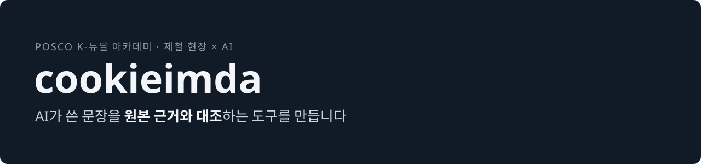
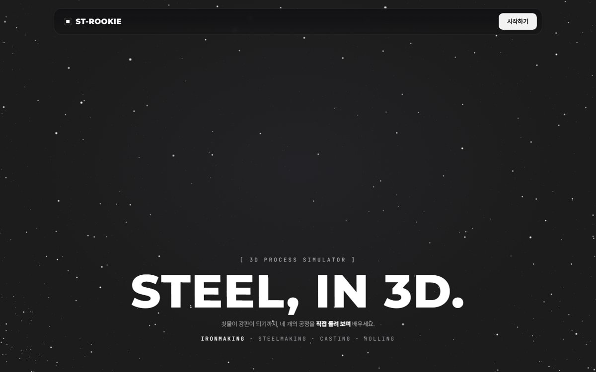
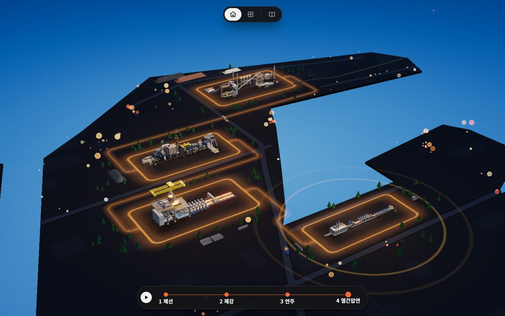
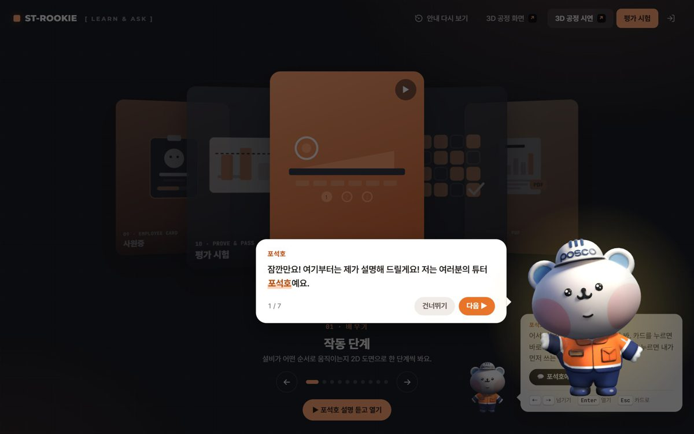

<!-- cookieimda/cookieimda 프로필 README -->
<!-- 구성: 배너 → 소개 → 작업 기록(월별 장 · 프로젝트별 토글, 최신이 위) → 기술 스택 -->
<!-- 새 작업은 해당 월 장 맨 위에 
 하나를 복사해 추가 -->
<!-- 원칙: 이모지 금지 · 강조색 1개 · 그라데이션 0 · 비공개 저장소는 링크 없이 '비공개'로만 표기 -->

제철소 현장의 문제를 AI와 소프트웨어로 해결합니다.
도구를 설계할 때 지키는 단 하나의 원칙이 있습니다.

> **숫자는 코드가 계산하고, 문장은 AI가 설명하며, 근거가 없으면 멈춘다.**

[ST-ROOKIE 라이브 데모](https://steel-rookie-dx-onboarding.onrender.com) · [전체 저장소 보기](https://github.com/cookieimda?tab=repositories)

 

## 작업 기록

최신 작업이 위에 있습니다. 제목을 누르면 자세한 내용이 펼쳐집니다.

| 기간 | 프로젝트 | 한 줄 | 규모 |
|:--|:--|:--|:--|
| 2026.10.07 – 진행 중 | 통해 | 이주노동자 생활 대화 도우미 앱 | PR **49**건 병합 · 비공개 테스트 중 |
| 2026.11.09 – 11.10 | STEEL MIND | 제철소 돌발상황 대처 진단 시뮬레이션 | 해커톤 · 4인 팀 |
| 2026.11.09 – 11.10 | SIGNAL | 현장 기록 AI 요약 검증기 | 해커톤 · 개인 작업 |
| 2026.10.29 – | EDA Studio v02 | 로컬 데이터 분석·문서 도구 | 개인 작업 |
| 2026.09.30 – 10.21 | ST-ROOKIE | 제철소 신입사원 3D 공정 교육 플랫폼 | 5인 팀 · 커밋 **154**/480 |
| 2026.09 | 생산착수 시뮬레이터 | 자재 부족 예측 대시보드 UI/UX 개선 | 개인 작업 |

 

### 진행 중

<b>통해</b> · 이주노동자 생활 대화 도우미 앱 · 2026.10.07 – 진행 중

 

이주노동자가 일터·시장·집 계약처럼 중요한 대화를 앞두고 할 말을 준비하고, 현장에서는 한국어로 대신 말해 주는 앱입니다. 2026 모두의 AI 실험실 AI 서비스 개발 프로젝트로 진행하고 있으며, 현재 비공개 테스트 중이라 화면과 저장소는 공개하지 않습니다.

| 진행 상태 | 기여 |
|:--|:--|
| 비공개 테스트 중 | Pull Request **49**건 병합 |

**핵심 담당 역할**
- 앱 프로토타입 제작과 이후 앱 개발 전반 (설치형 웹앱 + iOS 빌드·배포)
- 현장 대화 추천을 규칙 엔진으로 먼저 보여 주고 AI 답으로 보완하는 구조
- 4개 언어 원어민 검수 목록과 검수 결과를 앱 문구에 넣는 도구 제작
- UI 검토 반영: 화면 9개 개편, 색 대비 · 글자 크기 8단계 · 누르는 칸 44px 기준 적용

저장소 비공개

 

### 2026년 11월

<b>STEEL MIND</b> · 제철소 돌발상황 대처 진단 시뮬레이션 · 2026.11.09 – 11.10

 

> 열간압연 라인에서 발생한 조압연기 바(Bar) 쏠림 현상을 두고, 네 명의 동료가 각기 다른 조치를 제안하는 의사결정 회의 시뮬레이션

작업자가 열연 라인 현장을 순회하며 돌발상황을 해결하면, 정량적 평가는 규칙 엔진이 수행하고 AI는 취약 역량을 분석해 다음 시나리오를 동적으로 출제합니다.

| 기간 및 규모 | 시나리오 볼륨 |
|:--|:--|
| POSCO K-뉴딜 내부 해커톤 · 팀 '철든신입' 4인 | 열연 돌발 사건 **12**종 · 핵심 대처 역량 **5**가지 · 분기 경로 **729**개 |

**핵심 담당 역할**
- AI가 생성한 Agent 대사를 검수할 수 있도록 기준이 되는 기본 대화 정리 (AI 응답 실패 시 대체 대사로도 사용)
- 사건별 선택지·결과 진단을 생성하는 LLM 연동과 응답 형식 검사
- 결과 화면의 재훈련 전후(BEFORE / AFTER) 비교 막대, 공정 지도(M키)와 타이틀 화면 아트 구현

  

[팀 원본 저장소](https://github.com/steel-rookie/steel-mind)

<b>SIGNAL</b> · 현장 기록 AI 요약 검증기 · 2026.11.09 – 11.10

 

현장 인계 기록의 AI 요약본을 원본과 한 줄씩 대조해 할루시네이션(없는 완료 · 수치 오류 · 누락)을 탐지합니다. 검증을 통과한 기록만 이어서, 여러 단계를 따라가야 하는 질문에도 지어내지 않고 답합니다.

| 엔지니어링 검증 근거 |
|:--|
| 실제 AI 출력 **30**회 교차 채점 · 로컬 Ollama 미작동 시 규칙 기반 폴백(Fallback) 지원 · DB 시험 **40**개 |

POSCO K-뉴딜 해커톤 개인 작업 · 저장소 비공개

 

### 2026년 10월

<b>EDA Studio v02</b> · 로컬 데이터 분석·문서 도구 · 2026.10.29 –

 

외부 네트워크 없이 로컬 PC에서 완결되는 데이터 분석 및 발표 덱 자동 생성 도구입니다. 분석(EDA Studio), 문서 요약(Doc Brief), 프로젝트 파이프라인(CSV → 진단 → 모델 → 슬라이드) 세 작업공간을 한 창에서 오갑니다.

| 엔지니어링 검증 근거 |
|:--|
| 앱 내 산출 수치를 pandas · statsmodels 연산 결과와 대조하는 자동 검증 스크립트 구축 |

개인 작업 · 저장소 비공개

 

### 2026년 9월

<b>ST-ROOKIE</b> · 제철소 신입사원 3D 공정 교육 플랫폼 · 2026.09.30 – 10.21

 

> 고로 조업 조건을 변경하면 전광판과 용선 온도 다이얼이 실시간으로 반응하는 인터랙티브 3D 공정 환경

제철 4대 공정을 3D로 직접 조작하며 원리를 익히고, LLM 튜터 질의응답부터 구술형 이해도 평가까지 하나의 학습 흐름으로 연결한 온보딩 프로토타입입니다. 서비스 아이디어와 화면 흐름 대부분을 직접 기획하고 구현했습니다.

| 시작 화면 | 3D 공정 지도 | 학습 화면 |
|:--:|:--:|:--:|
|  |  |  |
| 첫 진입 · 로그인 | 4개 공정 설비 배치 | 카드형 학습 메뉴 · 튜터 안내 |

| 기간 및 규모 | 기여도 | 품질 |
|:--|:--|:--|
| 5인 팀 프로젝트 | 480 커밋 중 **154** 커밋 (약 32%) | 테스트 **510**개 통과 |

**핵심 담당 역할**
- 서비스 아이디어와 전체 화면 흐름 기획
- 시작 화면과 로그인 페이지, 3D 공장 부지 위 공정 설비 배치
- 학습 페이지 디자인: 카드형 학습 메뉴, 튜터 캐릭터 포석호와 음성 안내 투어
- 문헌 데이터 기반 What-if 공정 계산 모델 설계 및 검증 테스트 구축
- 조건 → 성분 → 결과 인과관계를 시각화한 시냅스 그래프 구현
- 사원증·학습 리포트 및 운영 통계 대시보드 개발

   

[라이브 데모 체험](https://steel-rookie-dx-onboarding.onrender.com) · 저장소 비공개

<b>생산착수 시뮬레이터</b> · 자재 부족 예측 대시보드 UI/UX 개선 · 2026.09

 

자재 부족을 사전 예측하는 업무용 대시보드의 화면을 v53 → v54로 고도화했습니다. 화면을 덩어리로 나누고, 각 덩어리의 시작점을 표시하고, 틀과 내용을 명도로 분리하는 원칙을 정리해 다음 화면 설계 체크리스트로 남겼습니다.

| 엔지니어링 검증 근거 |
|:--|
| 명암비를 실측해 WCAG 기준(4.5:1) 미달 요소(3.26:1 등) 식별 및 개선 |

개인 작업 · 저장소 비공개

 

## 기술 스택

| 분야 | 기술 |
|:--|:--|
| AI & LLM | Gemini API · Local Ollama · RAG · 루브릭 기반 LLM 평가 |
| Frontend | TypeScript · Three.js · HTML5/CSS3 (No-build 정적 웹 아키텍처) |
| Backend & DB | Node.js · Python (표준 라이브러리 서버) · FastAPI · SQLite |
| Game / Simulation | Unity 6 · C# |
| Data & Visualization | pandas · statsmodels · Chart.js |
