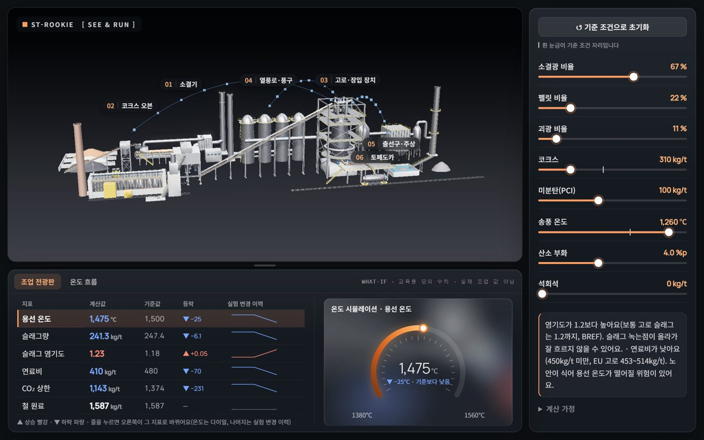
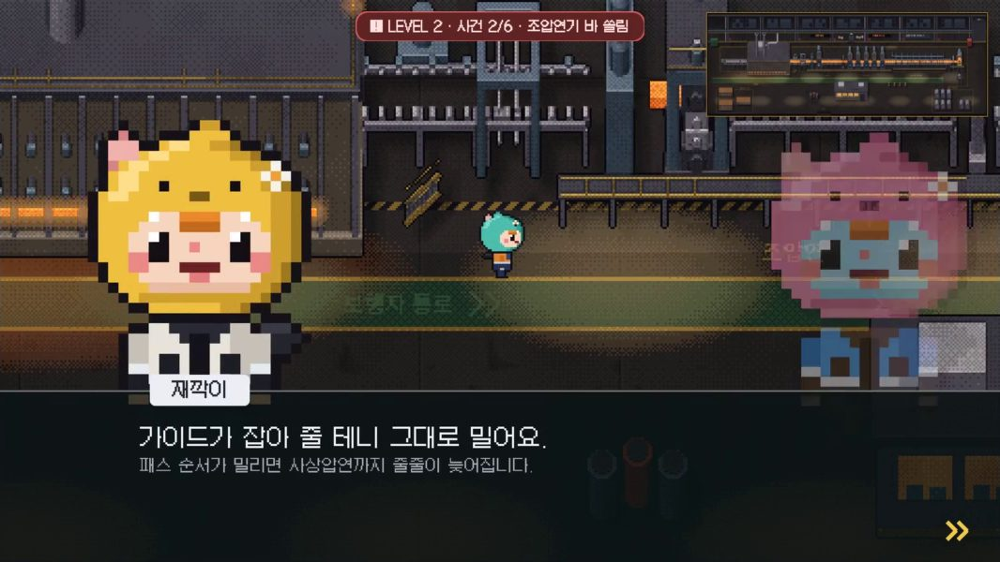

<!-- cookieimda/cookieimda 저장소의 README.md 로 쓰는 프로필 -->
<!-- 원칙: 주인공 1개 · 강조색 1개(열연 주황) · 그라데이션 0 · 장식 애니메이션 0 -->

제철소 현장의 문제를 AI와 소프트웨어로 해결합니다.
도구를 설계할 때 지키는 단 하나의 원칙이 있습니다.

> **숫자는 코드가 계산하고, 문장은 AI가 설명하며, 근거가 없으면 멈춘다.**

[ST-ROOKIE 라이브 데모](https://steel-rookie-dx-onboarding.onrender.com) · [전체 저장소 보기](https://github.com/cookieimda?tab=repositories)

 

## 대표 프로젝트

### 1. ST-ROOKIE · 제철소 신입사원 3D 공정 교육 플랫폼

> 고로 조업 조건을 변경하면 전광판과 용선 온도 다이얼이 실시간으로 반응하는 인터랙티브 3D 공정 환경

제철 4대 공정을 3D로 직접 조작하며 원리를 익히고, LLM 튜터 질의응답부터 구술형 이해도 평가까지 하나의 학습 흐름으로 연결한 온보딩 프로토타입입니다.

| 기간 및 규모 | 기여도 | 품질 |
|:--|:--|:--|
| 2026.09.30 – 10.21 · 5인 팀 | 480 커밋 중 **154** 커밋 (약 32%) | 테스트 **510**개 통과 |

**핵심 담당 역할**
- 문헌 데이터 기반 What-if 공정 계산 모델 설계 및 검증 테스트 구축
- 조건 → 성분 → 결과 인과관계를 시각화한 시냅스 그래프 구현
- 3D 학습 인터페이스, AI 튜터 캐릭터, 사원증·학습 리포트 및 운영 통계 대시보드 개발

   

[라이브 데모 체험](https://steel-rookie-dx-onboarding.onrender.com) · [GitHub 저장소](https://github.com/cookieimda/steel-rookie-dx-onboarding)

 

### 2. STEEL MIND · 제철소 돌발상황 대처 진단 시뮬레이션

> 열간압연 라인에서 발생한 조압연기 바(Bar) 쏠림 현상을 두고, 네 명의 동료가 각기 다른 조치를 제안하는 의사결정 회의 시뮬레이션

작업자가 열연 라인 현장을 순회하며 돌발상황을 해결하면, 정량적 평가는 규칙 엔진이 수행하고 AI는 취약 역량을 분석해 다음 시나리오를 동적으로 출제합니다.

| 기간 및 규모 | 시나리오 볼륨 |
|:--|:--|
| 2026.11.09 – 11.10 · POSCO K-뉴딜 내부 해커톤 · 팀 '철든신입' 4인 | 열연 돌발 사건 **12**종 · 핵심 대처 역량 **5**가지 · 분기 경로 **729**개 |

<!-- TODO 핵심 담당 역할 — 채우면 아래 주석을 풀기
**핵심 담당 역할**
- 
-->

  

[GitHub 저장소](https://github.com/cookieimda/steel-mind)

 

## 기타 프로젝트 및 엔지니어링 검증

단순 구현에 그치지 않고, 데이터 정합성과 웹 접근성까지 수치로 검증하며 만든 도구들입니다.

| 프로젝트 | 핵심 기능 | 엔지니어링 검증 근거 |
|:--|:--|:--|
| [**SIGNAL**](https://github.com/cookieimda/signal) | 현장 인계 기록의 AI 요약본을 원본과 대조해 할루시네이션(없는 완료·수치 오류·누락)을 탐지하는 검증기 | 실제 AI 출력 30회 교차 채점 · 로컬 Ollama 미작동 시 규칙 기반 폴백(Fallback) 지원 |
| [**EDA Studio**](https://github.com/cookieimda/eda-studio-v02) | 외부 네트워크 없이 로컬 PC에서 완결되는 데이터 분석 및 발표 덱 자동 생성 도구 (CSV → 진단 → 모델 → 슬라이드) | 앱 내 산출 수치를 pandas·statsmodels 연산 결과와 대조하는 자동 검증 스크립트 구축 |
| **생산착수 시뮬레이터** | 자재 부족을 사전 예측하는 업무용 대시보드 UI/UX 고도화 (v53 → v54) | 명암비를 실측해 WCAG 기준(4.5:1) 미달 요소(3.26:1 등) 식별 및 개선 |

 

## 기술 스택

| 분야 | 기술 |
|:--|:--|
| AI & LLM | Gemini API · Local Ollama · RAG · 루브릭 기반 LLM 평가 |
| Frontend | TypeScript · Three.js · HTML5/CSS3 (No-build 정적 웹 아키텍처) |
| Backend & DB | Node.js · Python (표준 라이브러리 서버) · SQLite |
| Game / Simulation | Unity 6 · C# |
| Data & Visualization | pandas · statsmodels · Chart.js |
